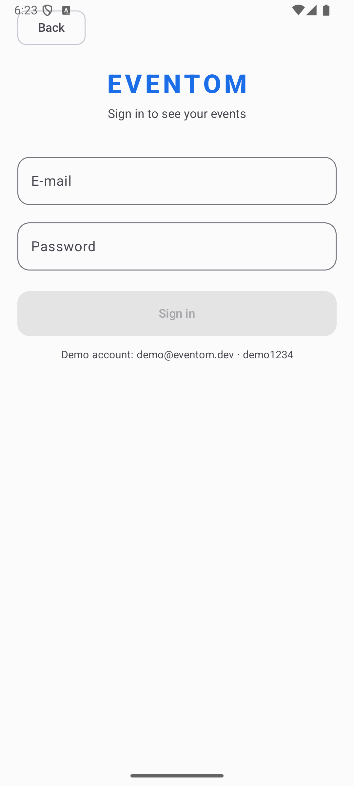
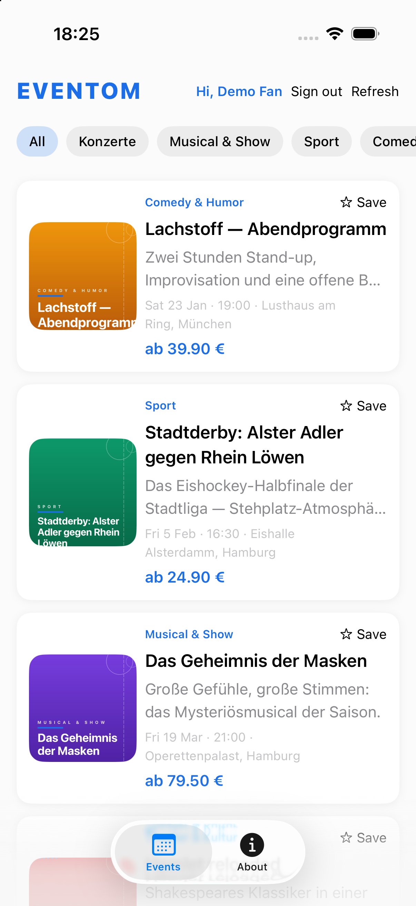
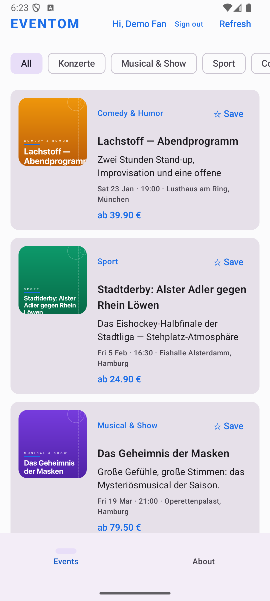
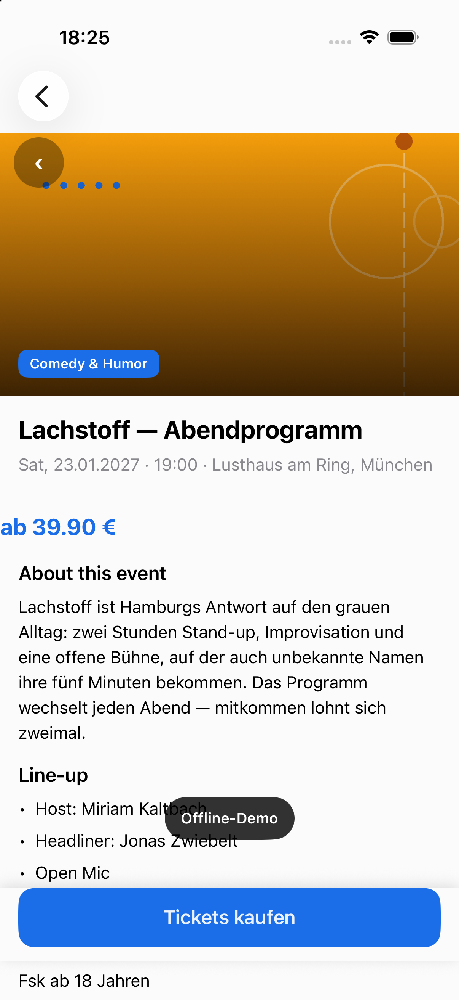

# EvenTom

A ticketing demo in the spirit of Eventim, built as a Kotlin Multiplatform
project. One shared Kotlin module holds everything that isn't UI, and the
two platform clients render fully natively — Jetpack Compose on Android,
SwiftUI on iOS.

It is a demo, and it says so up front: the "backend" ships inside the app,
the content is German, and nothing survives a relaunch. What's real is the
architecture and the test discipline around it.

| Android | iOS |
|---|---|
|  |  |

| | |
|---|---|
|  |  |

```text
┌────────────────────────────────────────────┐
│                 shared (KMP)               │
│  domain  : models, repository, contracts   │
│  data    : Ktor HTTP boundary + fixtures   │
│  present.: view models (StateFlow) + Koin  │
└─────────────┬──────────────────┬───────────┘
              │                  │
   ┌──────────▼──────┐  ┌───────▼─────────┐
   │  androidApp     │  │  iosApp         │
   │  Jetpack Compose│  │  SwiftUI        │
   └─────────────────┘  └─────────────────┘
```

## The fake backend

There is no server. A Ktor `MockEngine` sits where a real HTTP engine would
go and answers from JSON fixtures, so request serialization, response
headers, and DTO parsing all run through the genuine client pipeline:

- `GET /api/events` — event list (categories, prices, venues, image refs)
- `GET /api/event-details/{id}` — per-event details, 404 for unknown ids
- `POST /api/login` — `demo@eventom.dev` / `demo1234` works; anything else
  gets a 401

The fixtures live in `shared/src/commonMain/resources/api/`, mirrored as
compiled-in strings and guarded by a parity test — the build fails if either
copy drifts. Swapping in a real backend later is a config flag, not a
rewrite.

Why fake the engine boundary instead of stubbing the repository? Because a
stub proves nothing: it skips exactly the layer where real apps break. Done
this way, the network itself is the only pretend part.

## Posters

`tools/generate_posters.py` draws all twelve posters with Pillow and writes
them for both platforms in a single run — Android `drawable-nodpi` and iOS
`Posters.xcassets`, each poster in two sizes (hero 1200×1500, thumbnail
480×600). Rerunning the script reproduces the files byte for byte.

## Building and running

Prerequisites: JDK 17+, the Android SDK, and Xcode (tested with Xcode 27 and
the iOS 26.5 simulator).

```bash
./gradlew build                       # everything + shared-module tests
./gradlew :androidApp:installDebug    # Android on a device/emulator

open iosApp/iosApp.xcodeproj          # iOS, ⌘R
```

There is no CocoaPods; the Xcode project's Run Script phase calls
`./gradlew :shared:embedAndSignAppleFrameworkForXcode`.

## Testing

- `shared/src/{commonTest,androidHostTest}` — 67 tests (34 on the JVM, 33 as
  Kotlin/Native on the iOS simulator) covering the fake-backend pipeline, the
  repository, the auth and detail view models, fixture parity, and the
  no-fallback error paths.
- `androidApp/src/androidTest` — a single connected Compose walkthrough of
  the full journey, with navigation route assertions along the way.
- `iosApp/iosAppUITests` — a six-test XCUITest walkthrough: splash, login
  form, the login journey (posters, save round trip, chip scrolling,
  refresh), the wrong-password path, the detail journey, and sign-out.

```bash
xcodebuild test -project iosApp/iosApp.xcodeproj -scheme iosApp \
  -destination 'platform=iOS Simulator,name=iPhone 17 Pro'
```

## Layout

```
settings.gradle.kts
gradle/libs.versions.toml  # every dependency version in one place
tools/generate_posters.py  # deterministic poster generator (both platforms)
shared/src/commonMain/     # domain, data, presentation, core, session, di, fixtures
shared/src/*Main/          # platform engines via expect/actual
androidApp/                # Compose UI only
iosApp/iosApp/             # SwiftUI sources + Posters.xcassets
```

One rule shapes the layout: whatever isn't UI goes into `shared/`, and
whatever isn't logic stays out of `shared/`.

## Notes for agents (and the curious)

`AGENTS.md` records the conventions, the review/QA standards, and the
platform gotchas that were paid for in QA — including which corners were
deliberately cut, and why. `HUMANS.md` is the short version of the same
story.

## License

MIT — see [LICENSE](LICENSE).

The best code in this repo is the code it doesn't contain: no manual JSON
parsing, no image-loader dependency, no navigation framework on iOS — the
platforms already provide all three, and the diff stays honest about what
was actually needed.